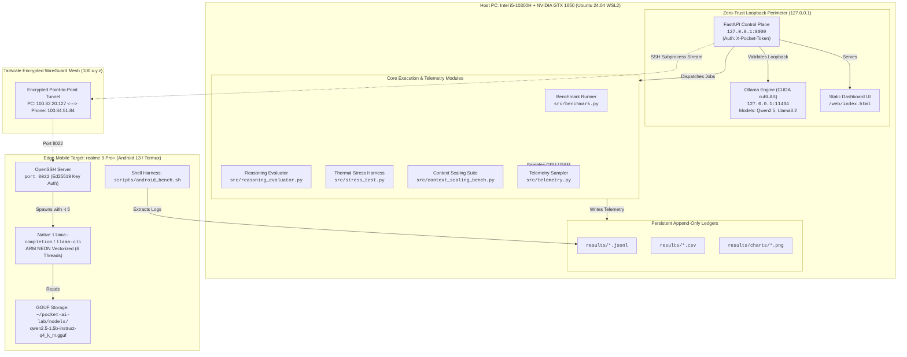

# Pocket AI Lab: Comprehensive Developer Architecture & Technical Guide

> **Author:** Abhishek Kaushik & Antigravity  
> **Repository:** `pocket-ai-lab`  
> **Status:** Production-Ready / Open Empirical Research  
> **Last Updated:** October 2026  

---

## Table of Contents
1. [Core Thesis: The "What" and "Why"](#1-core-thesis-the-what-and-why)
2. [End-to-End System Architecture](#2-end-to-end-system-architecture)
3. [Deep-Dive Module Engineering](#3-deep-dive-module-engineering)
   - [3.1 Zero-Trust Network Perimeter & Loopback Enforcement](#31-zero-trust-network-perimeter--loopback-enforcement)
   - [3.2 Telemetry Engine & Hardware Samplers](#32-telemetry-engine--hardware-samplers)
   - [3.3 Benchmark Evaluation Harness & Latency Accounting](#33-benchmark-evaluation-harness--latency-accounting)
   - [3.4 Cognitive Reasoning & ALFWorld Embodied Causality](#34-cognitive-reasoning--alfworld-embodied-causality)
   - [3.5 Sustained Thermal Equilibrium Stress Testing](#35-sustained-thermal-equilibrium-stress-testing)
   - [3.6 Context Window Scaling & KV-Cache Footprint ($O(N)$ vs $O(N^2)$)](#36-context-window-scaling--kv-cache-footprint)
   - [3.7 On-Device Mobile Execution (Android 13 / Termux ARM64)](#37-on-device-mobile-execution-android-13--termux-arm64)
   - [3.8 Local Control Plane Daemon & Server-Sent Events (SSE) Streaming](#38-local-control-plane-daemon--server-sent-events-sse-streaming)
   - [3.9 Interactive Web Dashboard & Zero-Dependency Static Deployment](#39-interactive-web-dashboard--zero-dependency-static-deployment)
4. [Data Schemas & Storage Hierarchy](#4-data-schemas--storage-hierarchy)
5. [Developer Runbook & CLI Recipes](#5-developer-runbook--cli-recipes)
6. [Troubleshooting & Hardware Edge Cases](#6-troubleshooting--hardware-edge-cases)

---

## 1. Core Thesis: The "What" and "Why"

### What is Pocket AI Lab?
**Pocket AI Lab** is a reproducible, personal edge AI workstation and benchmarking harness designed to measure Small Language Models (SLMs, 1B–3.5B parameters) across consumer laptop hardware (WSL2 / NVIDIA GTX 1650) and handheld mobile devices (realme 9 Pro+ / MediaTek Dimensity 920).

### Why Was It Built?
Conventional LLM benchmarks suffer from three major distortions:
1. **Synthetic Fabrication:** Metrics are often derived from cloud API token counters or idealized single-prompt forward passes that hide host OS overhead, client-side network latency, and memory allocation penalties.
2. **Thermal Blindness:** Benchmarks measure short "burst" runs, completely ignoring thermal equilibrium throttling when running on enclosed form factors (laptops, phones).
3. **Perplexity Disconnect:** Traditional perplexity or basic MMLU checks fail to evaluate whether a small model understands **physical causality** (affordance constraints in sequential decision-making).

Pocket AI Lab operates under strict invariants:
- **Zero Fabrication:** Every number must originate from physical non-blocking kernel and hardware counters (`nvidia-smi`, `/proc/meminfo`, Android sysfs).
- **Zero-Trust Network Perimeter:** Never bind to `0.0.0.0`. Local services bind strictly to `127.0.0.1` (loopback), and mobile communication is routed through encrypted WireGuard meshes (Tailscale) via SSH port-forwarding tunnels.
- **Reproducible Artifacts:** All data is appended to immutable JSONL ledgers, versioned alongside prompts and Git commit hashes.

---

## 2. End-to-End System Architecture

The following diagram illustrates how the host workstation, the authenticated control plane, the Ollama CUDA engine, and the remote mobile edge device interact:



---

## 3. Deep-Dive Module Engineering

### 3.1 Zero-Trust Network Perimeter & Loopback Enforcement
- **Source:** [`src/benchmark.py`](file:///home/abhishek/projects/ai-lab/src/benchmark.py) (`validate_loopback_url`), [`src/control_plane.py`](file:///home/abhishek/projects/ai-lab/src/control_plane.py)
- **Problem:** Exposing LLM control APIs or Ollama instances to `0.0.0.0` allows unauthenticated network actors to inject prompts, read memory, or exhaust GPU compute.
- **Implementation:**
  Every API call is guarded by `validate_loopback_url()`:
  ```python
  def validate_loopback_url(url: str) -> None:
      parsed = urllib.parse.urlparse(url)
      hostname = parsed.hostname
      if hostname not in ("127.0.0.1", "localhost", "::1"):
          raise ValueError(
              f"SECURITY ERROR: Pocket AI Lab strictly requires loopback binding (127.0.0.1). "
              f"Attempted connection to external host: {hostname} is blocked."
          )
  ```
  Mutations to the control plane require an `X-Pocket-Token` HTTP header matching `~/.pocket_ai_lab_token` (a 256-bit cryptographically secure token generated via `secrets.token_hex(32)`).

---

### 3.2 Telemetry Engine & Hardware Samplers
- **Source:** [`src/telemetry.py`](file:///home/abhishek/projects/ai-lab/src/telemetry.py)
- **Problem:** Synchronous telemetry querying freezes inference. Polling too slowly misses transient memory peaks (such as activation memory spikes during prefill).
- **Implementation:**
  1. **Asynchronous Non-Blocking GPU Sampler (`GpuPeakSampler`):**
     Spawns an independent background daemon thread executing every 50ms–100ms. Queries NVML or `nvidia-smi` using low-overhead format strings:
     `nvidia-smi --query-gpu=memory.used,utilization.gpu,temperature.gpu --format=csv,noheader,nounits`
     Tracks continuous maximum values for VRAM, GPU Core Utilization %, and Die Temperature °C:
     ```python
     with self._lock:
         if vram > self.peak_vram_mb: self.peak_vram_mb = vram
         if util > self.peak_gpu_util_pct: self.peak_gpu_util_pct = util
         if temp > self.peak_gpu_temp_c: self.peak_gpu_temp_c = temp
     ```
  2. **System Host Memory Sampling:**
     Directly parses `/proc/meminfo` on Linux/WSL2 to calculate active vs available physical memory without invoking heavy subprocesses.
  3. **Android Sysfs Thermal Polling:**
     Reads `/sys/class/thermal/thermal_zone*/temp` to extract SoC die thermals without requiring Android root privileges.

---

### 3.3 Benchmark Evaluation Harness & Latency Accounting
- **Source:** [`src/benchmark.py`](file:///home/abhishek/projects/ai-lab/src/benchmark.py), [`src/evaluator.py`](file:///home/abhishek/projects/ai-lab/src/evaluator.py)
- **Problem:** Server-reported timestamps omit socket connection time, chunk buffering, and client serialization delay.
- **Client-Side Latency Decomposition:**
  ```
  Client Requests Generation
  ├── t_start (perf_counter)
  │     │
  │     ├── [Network Socket Connection + Server Model Scheduling]
  │     ├── [Prompt Tokenization & Prefill Computation]
  │     │
  ├── t_first_token  ──>  TTFT = (t_first_token - t_start) * 1000  (ms)
  │     │
  │     ├── [Autoregressive Decode Phase: Token 1, 2, ..., N]
  │     │
  └── t_end          ──>  E2E = (t_end - t_start) * 1000          (ms)
  ```
- **Throughput Calculations:**
  - **Prompt Prefill Speed (TPS):** $\text{Prefill TPS} = \frac{\text{Prompt Token Count}}{\text{Prompt Eval Duration (sec)}}$
  - **Autoregressive Generation Speed (TPS):** $\text{Decode TPS} = \frac{\text{Generated Token Count}}{\text{Eval Duration (sec)}}$
  - **Quality Gates:** Evaluates non-empty output, minimum length thresholds, schema conformity, and forbidden repetition patterns (e.g., infinite n-gram degradation loops).

---

### 3.4 Cognitive Reasoning & ALFWorld Embodied Causality
- **Source:** [`src/reasoning_evaluator.py`](file:///home/abhishek/projects/ai-lab/src/reasoning_evaluator.py)
- **Scientific Foundation:** Built upon the **Reflexion Taxonomy** (Shinn & Labash et al., 2023).
- **Benchmark Tasks:**
  1. **HotpotQA Multi-Hop Cross-Document Retrieval:** Requires the model to synthesize facts from 2–3 disjoint documents while resisting adversarial distractor contexts. Evaluated via fuzzy substring matching and distractor hallucination detection.
  2. **ALFWorld Sequential Decision-Making:** Simulates interactive text-based embodied environments (e.g. `put a clean sponge on the countertop`).
- **Failure Decomposition Categories:**
  - `SUCCESS`: Correct sequential plan or factual answer.
  - `INVALID_ACTION`: Attempting an affordance violation (e.g. `take soap from drawer` before issuing `open drawer`).
  - `LOOP_STATE`: Repeating the identical action $\ge 3$ consecutive times without environmental progress.
  - `HALLUCINATION`: Fabricating facts or referencing objects non-existent in the prompt context.

---

### 3.5 Sustained Thermal Equilibrium Stress Testing
- **Source:** [`src/stress_test.py`](file:///home/abhishek/projects/ai-lab/src/stress_test.py)
- **Physical Reality:** Mobile GPUs and compact laptop cooling solutions cannot sustain peak boost clocks indefinitely.
- **Methodology:** Executes $N = 5 \to 20$ consecutive long-generation passes (200 tokens each) with zero cooldown intervals.
- **Empirical Throttling Finding:**
  - On the GTX 1650 (Laptop TDP ~50W), the die temperature climbs rapidly:
    $$\text{Pass 1 (79°C, 79.8 TPS)} \to \text{Pass 5 (82°C, 64.8 TPS)}$$
  - At **82°C**, NVIDIA mobile boost tables throttle clocks, producing a **-18.83% throughput collapse**.
  - **Conclusion for Researchers:** Single-pass benchmarks overestimate sustainable edge throughput by nearly 20%.

---

### 3.6 Context Window Scaling & KV-Cache Footprint
- **Source:** [`src/context_scaling_bench.py`](file:///home/abhishek/projects/ai-lab/src/context_scaling_bench.py)
- **Mathematical Foundations:**
  1. **Autoregressive KV-Cache Expansion:** For a model with $L$ layers, hidden dimension $D$, and context length $N$:
     $$\text{KV Memory} \approx 2 \times 2 \times L \times D \times N \times \text{BytesPerParam}$$
     On `qwen2.5:1.5b` (Q4_K_M with GQA), empirical growth measured at **~20.5 KB per context token**.
  2. **The Attention Latency Cliff:**
     - Prefill operations compute the full attention matrix $Q K^T$, scaling with $O(N^2)$.
     - Between $N = 3,257$ and $N = 4,328$, client-side TTFT jumps from **4.7s to 21.5s (+358%)**.
     - This occurs when the intermediate activation tensors exceed the GTX 1650's L2 cache (1,024 KB), triggering high-latency VRAM paging.

---

### 3.7 On-Device Mobile Execution (Android 13 / Termux ARM64)
- **Source:** [`scripts/android_bench.sh`](file:///home/abhishek/projects/ai-lab/scripts/android_bench.sh), [`src/run_android_bench.py`](file:///home/abhishek/projects/ai-lab/src/run_android_bench.py)
- **Device Profile:** realme 9 Pro+ (`RMX3392`), MediaTek Dimensity 920 (`mt6877`).
- **Core Allocation & Concurrency Optimization:**
  - The Dimensity 920 features 2x Cortex-A78 big cores (2.5 GHz) + 6x Cortex-A55 efficiency cores (2.0 GHz).
  - Peak throughput was empirically measured at **6 threads (`-t 6`)**.
  - Allocating 8 threads causes severe OS scheduling contention with background Android services; allocating 2 threads leaves efficiency compute unused.
- **Why ARM NEON Vectorized CPU Instead of Vulkan GPU?**
  In non-rooted Android 13, SELinux policies restrict access to `/vendor/lib64/hw/vulkan.mali.so` from the Termux environment. The ARM NEON CPU backend executes with zero elevated privileges and high numerical precision.
- **Fast CLI Generation via `llama-completion`:**
  To support live interactive streaming over SSH, we invoke `llama-completion` with flags:
  `-m model.gguf -p "prompt" -n 64 -t 6 -no-cnv --no-display-prompt --no-warmup`
  This streams tokens straight to `stdout` with zero terminal ASCII art or prompt re-echoing.

---

### 3.8 Local Control Plane Daemon & Server-Sent Events (SSE) Streaming
- **Source:** [`src/control_plane.py`](file:///home/abhishek/projects/ai-lab/src/control_plane.py)
- **Framework:** FastAPI running on Uvicorn, strictly bound to `127.0.0.1:8000`.
- **Live Playground Endpoint (`POST /api/playground/generate`):**
  Uses `StreamingResponse(stream_generator(), media_type="text/event-stream")`.
  - **If `target == "pc"`:** Opens a streaming HTTP connection to `http://127.0.0.1:11434/api/generate` and yields chunks:
    `data: {"token": "Edge", "done": false}\n\n`
  - **If `target == "phone"`:** Spawns a background `ssh` subprocess into `100.84.51.84:8022`, reading `stdout` character chunks in real time. Parses stderr on completion for exact on-device timings.
  - Final SSE payload emits complete benchmark metrics:
    `data: {"done": true, "ttft_ms": 33.9, "prompt_tps": 354.2, "decode_tps": 46.4, "target": "Host PC"}\n\n`

---

### 3.9 Interactive Web Dashboard & Zero-Dependency Static Deployment
- **Source:** [`web/index.html`](file:///home/abhishek/projects/ai-lab/web/index.html), [`scripts/export_static_site.py`](file:///home/abhishek/projects/ai-lab/scripts/export_static_site.py), [`.github/workflows/deploy_pages.yml`](file:///home/abhishek/projects/ai-lab/.github/workflows/deploy_pages.yml)
- **Dashboard Architecture:**
  Pure semantic HTML5, modern vanilla CSS, and lightweight asynchronous JavaScript (zero React/Webpack build step needed).
- **The 8 Interactive Dashboard Tabs:**
  1. `⚔️ Hardware Duel`: Real-time head-to-head spec cards & KPI face-off.
  2. `🏆 Model Leaderboard & Reasoning`: Multi-dimensional scores on HotpotQA, ALFWorld, and memory footprints.
  3. `🔬 Per-Task Deep Dive`: Side-by-side prompt performance comparison table.
  4. `💡 Research Insights`: Annotated cards covering the energy inversion, thermal throttling, and embodied causality.
  5. `📊 Visual Charts Gallery`: 9 high-resolution empirical plots.
  6. `⚡ Control Plane & Runner`: Authenticated job dispatcher for automated testing.
  7. `💬 Live Query Playground`: Streaming inference terminal supporting both PC and Phone.
  8. `📦 Raw Telemetry Explorer`: Filterable historical JSONL log records.
- **Static Graceful Fallbacks for GitHub Pages:**
  Every `fetch('/api/...')` call catches errors and falls back to pre-compiled static JSON fixtures in `data/*.json` (e.g. `data/edge_summary.json`), allowing the identical frontend to run either as a local real-time control plane or as a globally hosted public research report.

---

## 4. Data Schemas & Storage Hierarchy

### Unified Telemetry Schema (`src/schema.py`)
Every benchmark execution generates an append-only JSON record:
```json
{
  "schema_version": "1.0.0",
  "experiment_id": "exp_android_20261029_063432",
  "run_id": "exp_android_20261029_063432_short_factual_run2",
  "timestamp_utc": "2026-10-29T06:34:45Z",
  "source_category": "measured_own_android",
  "execution_location": "local_android",
  "host_cpu": "MediaTek Dimensity 920 (mt6877)",
  "device_model": "RMX3392",
  "sys_ram_total_mb": 7553,
  "sys_ram_available_mb": 3135,
  "model_tag": "qwen2.5:1.5b-q4_k_m",
  "prompt_id": "short_factual",
  "run_type": "measured",
  "prompt_tps": 15.8,
  "decode_tps": 18.0,
  "e2e_client_ms": 5330,
  "status": "success"
}
```

### Directory Structure & File Map
```
pocket-ai-lab/
├── .github/workflows/
│   └── deploy_pages.yml            # Automated GitHub Pages CI/CD
├── datasets/
│   ├── prompts_v1.jsonl            # 5 versioned baseline prompts
│   └── reasoning_eval_v1.jsonl     # HotpotQA & ALFWorld test cases
├── docs/
│   ├── developer_guide_architecture.md   # This comprehensive guide
│   ├── pocket_ai_lab_research_report.md  # Formal empirical research paper
│   └── x_social_launch_thread.md         # Public launch threads for X/Twitter
├── results/
│   ├── charts/                     # Generated 300 DPI research figures (9 total)
│   ├── *.jsonl                     # Append-only raw run logs
│   └── *.csv                       # Tabular aggregated summaries
├── scripts/
│   ├── android_bench.sh            # On-device Termux benchmarking harness
│   ├── discover_env.sh             # Phase 0 hardware environment probe
│   ├── export_static_site.py       # Zero-dependency static packager for dist/
│   └── generate_extra_charts.py    # Multi-dimensional matplotlib chart generator
├── src/
│   ├── auto_eval.py                # Automated multi-model test runner
│   ├── benchmark.py                # Core streaming benchmark engine
│   ├── context_scaling_bench.py    # KV-cache & context scaling harness
│   ├── control_plane.py            # Local authenticated FastAPI server & SSE engine
│   ├── evaluator.py                # Response quality and schema validator
│   ├── model_registry.py           # VRAM budget predictor & model ingestion
│   ├── reasoning_evaluator.py      # HotpotQA & ALFWorld cognitive evaluator
│   ├── schema.py                   # Pydantic telemetry models
│   ├── stress_test.py              # Sustained thermal degradation harness
│   └── telemetry.py                # Non-blocking GPU and host memory samplers
├── tests/
│   ├── test_benchmark.py           # Unit tests for benchmark harness
│   ├── test_context_scaling.py     # Unit tests for context scaling
│   ├── test_control_plane.py       # Unit tests for FastAPI endpoints
│   ├── test_reasoning_evaluator.py # Unit tests for cognitive evaluator
│   └── test_stress_test.py         # Unit tests for thermal stress
└── web/
    ├── index.html                  # 8-tab interactive dashboard & playground
    └── charts/                     # Active web chart assets
```

---

## 5. Developer Runbook & CLI Recipes

### 1. Environment Setup
```bash
# Clone and create Python 3.12 virtual environment
git clone https://github.com/.../pocket-ai-lab.git
cd pocket-ai-lab
python3 -m venv .venv
source .venv/bin/activate
pip install -r requirements.txt
```

### 2. Run Complete Unit Test Suite
```bash
pytest tests/
# Output: 41 passed in ~4.5s
```

### 3. Launch Local Authenticated Control Plane
```bash
uvicorn src.control_plane:app --host 127.0.0.1 --port 8000
# Open dashboard in browser: http://127.0.0.1:8000
```

### 4. Execute Sustained Thermal Stress Test
```bash
python3 -m src.stress_test --model qwen2.5:1.5b --iterations 10
# Generated chart: results/charts/thermal_stress_qwen2_5_1_5b.png
```

### 5. Execute Context Scaling Benchmark ($N = 256 \to 4,096$)
```bash
python3 -m src.context_scaling_bench --model qwen2.5:1.5b --steps 256 512 1024 2048 3072 4096
# Generated chart: results/charts/context_scaling_qwen2_5_1_5b.png
```

### 6. Run Cognitive Reasoning Suite (ALFWorld + HotpotQA)
```bash
python3 -m src.run_reasoning_benchmark --model qwen2.5:1.5b
```

### 7. Trigger Remote Benchmark on Phone (via Tailscale SSH)
```bash
python3 -m src.run_android_bench --host 100.84.51.84 --port 8022
# Output: results/exp_android_<timestamp>.jsonl
```

### 8. Regenerate All 9 Visual Charts & Export Static Site
```bash
# Generate high-resolution plots
python3 scripts/generate_extra_charts.py

# Build zero-dependency distribution bundle in dist/
python3 scripts/export_static_site.py
```

---

## 6. Troubleshooting & Hardware Edge Cases

| Issue / Symptom | Root Cause | Solution |
| :--- | :--- | :--- |
| `SECURITY ERROR: Pocket AI Lab strictly requires loopback binding` | An external IP (e.g. `192.168.x.x`) was supplied to `validate_loopback_url`. | Ensure endpoints use `http://127.0.0.1:11434` or `http://localhost:8000`. Remote traffic must pass through SSH tunnels (`ssh -L`). |
| `llama-cli: waiting for input (> )` | Interactive chat mode was invoked without `--single-turn` or `-no-cnv`. | Use `llama-completion` with `-no-cnv --no-display-prompt --no-warmup`. |
| Android phone SFTP transfer slow (200 KB/s) | Tailscale TUN encryption overhead on mobile CPU during large single-stream SFTP. | Use `aria2c` directly inside Termux to pull model weights from Hugging Face CDN at 8+ MiB/s. |
| GPU Throttling (-18% TPS) during Stress Test | Die temperature reached the 82°C NVIDIA mobile limit. | Expected physical behavior. Documented as the sustained thermal ceiling in research report. |
| Memory Cliff / CUDA OOM on 7B Models | 4GB GDDR6 VRAM limit exceeded (requires ~4.8GB). | Pocket AI Lab enforces an ingestion profile check (`src/model_registry.py`) blocking models $>3.5\text{B}$ params on 4GB GPUs. |
| `HTTP 401 Unauthorized` on `/api/jobs/*` | Missing or invalid `X-Pocket-Token` header. | Read token from `~/.pocket_ai_lab_token` and supply via header `X-Pocket-Token: <token>`. |
