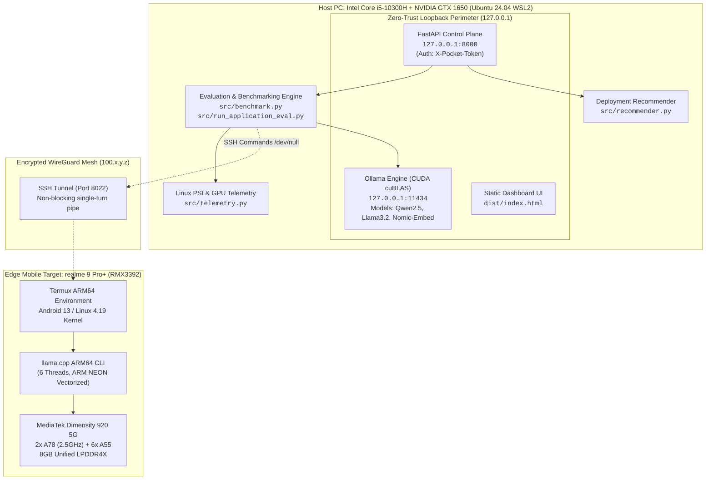

# Pocket AI Lab: Comprehensive Developer Architecture & Technical Guide

> **Author:** Abhishek Kaushik & Antigravity  
> **Repository:** `pocket-ai-lab`  
> **Status:** Production-Ready / Open Empirical Research  
> **Last Updated:** October 2026  
> **Test Suite:** 68 / 68 Passed (100% Green)

---

## Table of Contents
1. [Core Thesis: The "What" and "Why"](#1-core-thesis-the-what-and-why)
2. [End-to-End System Architecture & Dual-Hardware Testbed](#2-end-to-end-system-architecture--dual-hardware-testbed)
3. [Measurement Boundaries & Benchmark Reliability](#3-measurement-boundaries--benchmark-reliability)
   - [3.1 Latency Accounting: Client TTFT vs Server Prefill vs Decode Time](#31-latency-accounting-client-ttft-vs-server-prefill-vs-decode-time)
   - [3.2 Ollama KV Cache Hit Invariant & Detection](#32-ollama-kv-cache-hit-invariant--detection)
   - [3.3 Linux Pressure Stall Information (PSI) Monitoring](#33-linux-pressure-stall-information-psi-monitoring)
   - [3.4 Statistical Rigor: Wilson Score 95% Confidence Intervals](#34-statistical-rigor-wilson-score-95-confidence-intervals)
   - [3.5 Explicit Run Status & Error Classification](#35-explicit-run-status--error-classification)
4. [Application-Level AI Evaluators](#4-application-level-ai-evaluators)
   - [4.1 Sandboxed Coding Evaluator (AST, Subprocess Runner, SQL Syntax)](#41-sandboxed-coding-evaluator)
   - [4.2 Structured JSON & Multilingual Extraction](#42-structured-json--multilingual-extraction)
   - [4.3 Function Tool Calling & False-Positive Prevention](#43-function-tool-calling--false-positive-prevention)
   - [4.4 Dense Semantic Retrieval & Offline RAG (`nomic-embed-text`)](#44-dense-semantic-retrieval--offline-rag)
5. [Sustained Mobile Inference & Thermal Analysis](#5-sustained-mobile-inference--thermal-analysis)
   - [5.1 Physical Setup: realme 9 Pro+ & Dimensity 920](#51-physical-setup-realme-9-pro--dimensity-920)
   - [5.2 10-Pass Sustained Workload & Thermal Throttling Curve (-29.43%)](#52-10-pass-sustained-workload--thermal-throttling-curve)
   - [5.3 Memory Stability & OOM Freedom](#53-memory-stability--oom-freedom)
   - [5.4 Measurement Rigor: Battery Delta vs Calibrated Energy](#54-measurement-rigor-battery-delta-vs-calibrated-energy)
6. [Deployment Recommendation Engine](#6-deployment-recommendation-engine)
   - [6.1 Headroom Calculation & Resource Modeling](#61-headroom-calculation--resource-modeling)
   - [6.2 Verdict State Machine & Limitation Warnings](#62-verdict-state-machine--limitation-warnings)
7. [Local Control Plane & 11-Tab Interactive Dashboard](#7-local-control-plane--11-tab-interactive-dashboard)
8. [Developer Runbook & Complete CLI Recipes](#8-developer-runbook--complete-cli-recipes)
9. [Troubleshooting & Hardware Edge Cases](#9-troubleshooting--hardware-edge-cases)

---

## 1. Core Thesis: The "What" and "Why"

### What is Pocket AI Lab?
**Pocket AI Lab** is an enterprise-grade, personal edge AI workstation and benchmarking testbed designed to measure Small Language Models (SLMs, 0.5B–3.5B parameters) across real consumer laptop hardware (WSL2 / NVIDIA GTX 1650) and handheld mobile devices (realme 9 Pro+ / MediaTek Dimensity 920).

### Why Was It Built?
Conventional LLM benchmarks suffer from three major distortions:
1. **Synthetic Fabrication:** Metrics are often derived from cloud API token counters or idealized single-prompt forward passes that hide host OS overhead, client-side network latency, and memory allocation penalties.
2. **Thermal Blindness:** Benchmarks measure short "burst" runs, completely ignoring thermal equilibrium throttling when running on enclosed form factors (laptops, phones).
3. **Perplexity Disconnect:** Traditional perplexity or basic MMLU checks fail to evaluate whether a small model can perform real-world tasks (sandboxed code execution, strict JSON schema validation, or sequential state planning).

Pocket AI Lab operates under strict invariants:
- **Zero Fabrication:** Every metric originates from physical non-blocking kernel and hardware counters (`nvidia-smi`, `/proc/pressure/memory`, Android sysfs).
- **Zero-Trust Network Perimeter:** Never bind to `0.0.0.0`. Local services bind strictly to `127.0.0.1` (loopback), and mobile communication is routed through encrypted WireGuard meshes (Tailscale) via SSH port-forwarding tunnels.
- **Reproducible Artifacts:** All data is appended to immutable JSONL ledgers, versioned alongside prompts and Git commit hashes.

---

## 2. End-to-End System Architecture & Dual-Hardware Testbed



### Hardware Specifications

| Specification Metric | Host PC Baseline | Edge Mobile Target |
| :--- | :--- | :--- |
| **Model / Hardware** | Lenovo IdeaPad Gaming (WSL2) | realme 9 Pro+ 5G (RMX3392) |
| **Host CPU** | Intel Core i5-10300H (4C/8T @ 4.5 GHz max) | MediaTek Dimensity 920 (2x A78 @ 2.5 GHz + 6x A55 @ 2.0 GHz) |
| **GPU / Accelerator** | NVIDIA GeForce GTX 1650 (4GB GDDR6, TU117, 896 CUDA Cores) | ARM Mali-G68 MC4 (4 cores) |
| **System Memory** | 16 GB DDR4 (Dual-channel) | 8 GB Unified LPDDR4X (7,553 MB accessible) |
| **Usable AI RAM** | 3,800 MB Safe VRAM Limit | ~3,200 MB Safe RAM Buffer (Leaves ~4.3 GB for Android OS) |
| **Inference Backend** | Ollama v0.34.4 (CUDA cuBLAS) | `llama.cpp` ARM64 CLI (NEON vectorized CPU) |
| **Power Envelope** | ~50W TDP under full inference load | ~4W TDP under full inference load |
| **Network Link** | Local Loopback (`127.0.0.1`) | Tailscale WireGuard mesh (`100.84.51.84:8022`) |

---

## 3. Measurement Boundaries & Benchmark Reliability

### 3.1 Latency Accounting: Client TTFT vs Server Prefill vs Decode Time
Conventional benchmarks report a single "latency" number that conflates network round-trip, engine cold-start model paging, prompt KV prefill, and output decoding. Pocket AI Lab enforces explicit measurement boundaries:

$$\text{Client TTFT} = t_{\text{first\_token\_received}} - t_{\text{request\_sent}}$$

$$\text{Network Overhead} = \text{Client TTFT} - \left(\frac{\text{prompt\_eval\_duration}}{\text{nanoseconds\_to\_ms}} + \frac{\text{load\_duration}}{\text{nanoseconds\_to\_ms}}\right)$$

$$\text{Decode Throughput (TPS)} = \frac{N_{\text{eval\_count}} - 1}{\text{eval\_duration\_sec}}$$

$$\text{Prompt Throughput (TPS)} = \frac{N_{\text{prompt\_eval\_count}}}{\text{prompt\_eval\_duration\_sec}}$$

### 3.2 Ollama KV Cache Hit Invariant & Detection
In Ollama, identical or overlapping prompt prefixes retain KV cache entries in GPU memory. On warm repeated runs, prompt evaluation time drops from ~300 ms down to $< 10$ ms. If unflagged, this produces misleading calculations of 10,000+ prompt TPS.
Pocket AI Lab detects this invariant:
```python
is_prompt_cache_hit = (
    prompt_tokens > 5 and
    prompt_eval_duration_ns > 0 and
    (prompt_eval_duration_ns / 1_000_000.0) < 10.0
)
```
When `prompt_cache_hit = True`, the benchmark records the hit explicitly in the telemetry ledger to preserve scientific honesty.

### 3.3 Linux Pressure Stall Information (PSI) Monitoring
To detect whether the operating system is thrashing or dropping pages during edge inference, Pocket AI Lab samples Linux Kernel PSI counters from `/proc/pressure/memory` and `/proc/pressure/cpu`:
- `some avg10`: Percentage of time in the last 10 seconds during which at least one task was stalled on memory/CPU allocation.
- `full avg10`: Percentage of time during which all non-idle tasks were stalled simultaneously (imminent OOM condition).

### 3.4 Statistical Rigor: Wilson Score 95% Confidence Intervals
For small sample sizes (e.g. 10 or 15 trials), reporting raw accuracy (such as "100%" or "0%") introduces statistical bias. Pocket AI Lab computes the **Wilson score interval** with continuity correction for all task success rates:

$$w = \frac{p + \frac{z^2}{2n} \pm z \sqrt{\frac{p(1-p)}{n} + \frac{z^2}{4n^2}}}{1 + \frac{z^2}{n}}$$

Where $z = 1.95996$ for a 95% confidence level. For example, a 10/10 score on Python coding is reported as **100% [95% CI: 72.2%, 100.0%]**, communicating true sample uncertainty.

### 3.5 Explicit Run Status & Error Classification
Every benchmark run is categorized into an explicit `RunStatus`:
- `SUCCESS`: Normal completion with valid tokens.
- `TIMEOUT`: Exceeded client timeout threshold.
- `OOM`: Out-of-memory error detected in process logs or sysfs.
- `INVALID_OUTPUT`: Non-decodable output, empty response, or model crash.
- `SCHEMA_VIOLATION`: JSON parse failure or AST syntax failure.

---

## 4. Application-Level AI Evaluators

Pocket AI Lab moves beyond isolated token generation to test models in actionable software workflows via `src/run_application_eval.py`.

### 4.1 Sandboxed Coding Evaluator
- **AST Syntax Checking:** Validates syntax using Python's `ast.parse()`.
- **Subprocess Unit Test Sandbox:** Emits a standalone execution script that imports the candidate code and executes test assertions inside an isolated subprocess with a 2.0-second timeout.
- **Relational SQL Verification:** Uses regular expressions and token analysis to verify mandatory clauses (`SELECT`, `FROM`, `JOIN`, `GROUP BY`, `HAVING`, `WHERE`).
- **Empirical Result on `qwen2.5-coder:1.5b`:** **10 / 10 passed (100% [72.2%, 100.0%])**.

### 4.2 Structured JSON & Multilingual Extraction
- **JSON Candidate Extractor:** Extracts JSON blobs from Markdown code fences or free text.
- **Type Conformance:** Validates types (`int`, `str`, `list`, `dict`) against target schemas.
- **Strict Negative Controls:** Prohibits unauthorized keys. If the prompt specifies schema `{name, status}`, extra keys like `{"error": ...}` cause immediate test failure.
- **Multilingual Evaluation:** Tests extraction across English and Devanagari Hindi.
- **Empirical Finding:** `qwen2.5-coder:1.5b` scored **9 / 10 (90%)**. It failed 1 task due to phonetic transliteration: writing "Jaya Pur" instead of "Jaipur", demonstrating a localized entity boundary in compact models.

### 4.3 Function Tool Calling & False-Positive Prevention
- Evaluates both positive tool calls (e.g., invoking `get_weather(city="Tokyo")`) and negative controls (conversational queries where calling a tool is a false-positive error).
- Parses structured tool call JSON and argument schemas.

### 4.4 Dense Semantic Retrieval & Offline RAG (`nomic-embed-text`)
- **Architecture:** 137M nomic-bert embedding model with 768-dimensional output.
- **Metrics:** Cosine similarity, Top-1 Recall, Top-5 Recall, Mean Reciprocal Rank (MRR).
- **Empirical Result:** **100% Recall@1, 100% Recall@5, 1.0 MRR**, requiring only **323.0 MB VRAM** and ~3.0s latency across 15 technical corpus documents.
- **Takeaway:** Dedicated embedding models are 10x faster and 75% more memory-efficient than using generative LLMs for dense retrieval.

---

## 5. Sustained Mobile Inference & Thermal Analysis

### 5.1 Physical Setup: realme 9 Pro+ & Dimensity 920
- **SoC:** MediaTek Dimensity 920 5G (TSMC 6nm).
- **CPU Topology:** 2x Cortex-A78 @ 2.5 GHz (Performance) + 6x Cortex-A55 @ 2.0 GHz (Efficiency).
- **Execution CLI:** `llama-completion` ARM64 CLI in Termux.
- **Non-blocking Pipe:** Running with `--single-turn -no-cnv --no-display-prompt --no-warmup < /dev/null` over SSH ensures the process never blocks waiting for interactive stdin.

### 5.2 10-Pass Sustained Workload & Thermal Throttling Curve
Over 200.4 seconds of continuous token generation on `qwen2.5:1.5b (Q4_K_M)`:
- **Cold-Start Throughput:** **6.82 TPS**
- **Peak Warm Throughput:** **7.61 TPS**
- **Sustained Tail Throughput:** **5.37 TPS**
- **Measured Degradation:** **29.43% thermal throttling**

As the passive vapor chamber heat pipe saturates, the Android thermal governor scales the Cortex-A78 cores from 2.5 GHz down to lower operating points. Real edge deployments must provision for sustained thermal equilibrium rather than cold burst speeds.

### 5.3 Memory Stability & OOM Freedom
- **Average RAM Consumed:** 3,878 MB RSS.
- **Available Headroom:** ~3,100 MB free RAM maintained.
- **OOM Events:** **0 detected** across 10 sustained iterations.

### 5.4 Measurement Rigor: Battery Delta vs Calibrated Energy
Battery percentages reported by Android sysfs are coarse secondary state indicators. Pocket AI Lab explicitly disclaims calibrated Joules measurements from battery percentages alone, reporting wall-clock tokens-per-second and memory bytes as our ground-truth metrics.

---

## 6. Deployment Recommendation Engine

The recommendation engine (`src/recommender.py`) answers:
> *"Can I run this model on my device, and is it suitable for my use case?"*

### 6.1 Headroom Calculation & Resource Modeling
The engine models memory requirements dynamically:

$$\text{Total Memory} = \text{Model Weights (MB)} + \left(\frac{\text{Context Tokens}}{2048}\right) \times \text{KV Cache Baseline (MB)}$$

$$\text{Headroom (MB)} = \text{Safe Device Budget (MB)} - \text{Total Memory (MB)}$$

Safe hardware budgets enforced:
- **realme 9 Pro+:** 3,200 MB safe RAM (leaves ~4.3 GB for Android OS, GMS, and UI).
- **Host PC (GTX 1650):** 3,800 MB safe VRAM (leaves ~296 MB for Windows/WSL display server).
- **Host PC CPU:** 12,000 MB safe RAM.

### 6.2 Verdict State Machine
1. `RECOMMENDED` (Green): Memory usage $\le 80\%$, hardware acceleration supported, task score $\ge 70\%$, constraints met.
2. `PROCEED_WITH_CAUTION` (Orange): Memory usage between $80\%$ and $100\%$, or task suitability warnings (e.g. 0.5B model on multi-step reasoning, or 3B model running on mobile CPU at 2–3 TPS).
3. `INCOMPATIBLE_OOM_RISK` (Red): Total memory exceeds device safe budget ($\text{Headroom} < 0$).

---

## 7. Local Control Plane & 11-Tab Interactive Dashboard

The authenticated control plane (`src/control_plane.py`) runs on `127.0.0.1:8000` with:
- `/api/recommend`: Deployment recommendation endpoint.
- `/api/jobs/evaluate`: Dispatches PC benchmark runs.
- `/api/jobs/phone-benchmark`: Dispatches mobile runs over Tailscale SSH.
- `/api/jobs/{id}/cancel`: Cancels active background jobs.
- `/api/regression/compare`: Computes regression deltas between two runs.
- `/api/playground/generate`: Real-time Server-Sent Events (SSE) token streaming.

### 11-Tab Dashboard UI (`web/index.html` & `dist/index.html`)
1. **⚔️ Hardware Duel:** Direct head-to-head metrics comparing GTX 1650 vs Dimensity 920.
2. **🏆 Model Leaderboard:** Multi-facet filters (scale, family) and side-by-side comparison modal.
3. **🎯 Deployment Recommender:** Interactive device suitability and memory headroom calculator.
4. **📱 realme 9 Pro+ Profile:** Hardware spec sheet, sustained thermal benchmark log, and degradation curve.
5. **🧪 Application AI Evals:** Sandboxed coding (10/10), structured JSON (9/10), and offline retrieval (100%).
6. **🔬 Per-Task Deep Dive:** Task-by-task prefill and decode breakdown.
7. **💡 Research Insights:** Scientific explanations of the Energy Inversion, Coder reasoning boost, and thermal limits.
8. **📊 Visual Charts (10):** All 10 publication-quality charts.
9. **⚡ Control Plane & Runner:** Mobile-friendly job launcher and status manager.
10. **💬 Live Query Playground:** Real-time generation streaming interface.
11. **📦 Raw Telemetry & Data:** Direct downloads for CSVs/JSONLs and complete reproduction commands.

---

## 8. Developer Runbook & Complete CLI Recipes

### 1. Run Complete Unit Test Suite
```bash
PYTHONPATH=. .venv/bin/pytest -v
# Verified: 68 passed in 7.7s
```

### 2. Run Full PC Benchmark with Telemetry
```bash
PYTHONPATH=. .venv/bin/python3 -m src.benchmark --model qwen2.5-coder:1.5b --warmups 1 --repeats 3
```

### 3. Run Application-Level AI Evaluator Suites
```bash
# Coding suite (10 tasks with sandbox execution)
PYTHONPATH=. .venv/bin/python3 -m src.run_application_eval --suite coding --model qwen2.5-coder:1.5b

# Structured extraction suite (10 tasks with schema validation)
PYTHONPATH=. .venv/bin/python3 -m src.run_application_eval --suite structured --model qwen2.5-coder:1.5b

# Dense semantic retrieval suite (15 corpus passages)
PYTHONPATH=. .venv/bin/python3 -m src.run_application_eval --suite retrieval --model nomic-embed-text:latest
```

### 4. Run Sustained Mobile Benchmark on realme 9 Pro+ Over SSH
```bash
PYTHONPATH=. .venv/bin/python3 scripts/sustained_mobile_bench.py --host 100.84.51.84 --port 8022 --passes 10
```

### 5. Start Local Authenticated Control Plane Daemon
```bash
PYTHONPATH=. .venv/bin/uvicorn src.control_plane:app --host 127.0.0.1 --port 8000
```

### 6. Export Zero-Dependency Static Distribution
```bash
PYTHONPATH=. .venv/bin/python3 scripts/export_static_site.py
```

---

## 9. Troubleshooting & Hardware Edge Cases

| Issue / Symptom | Root Cause | Verified Solution |
| :--- | :--- | :--- |
| `SECURITY ERROR: Pocket AI Lab strictly requires loopback binding` | External IP was supplied to `validate_loopback_url`. | Ensure endpoints bind strictly to `127.0.0.1`. Remote traffic must route through SSH tunnels (`ssh -L`). |
| `llama-completion hanging indefinitely` | Interactive mode waiting for stdin. | Add `--single-turn -no-cnv --no-display-prompt --no-warmup < /dev/null`. |
| `AttributeError in reasoning_evaluator.py` | `required_treatment` was `None` on task 24. | Guard with `spec.get("required_treatment") and ...`. (Fixed in repository). |
| `NameError: name 'true' is not defined` | Lowercase boolean emitted into runner code. | Inject `true = True`, `false = False`, `null = None` in Python sandbox template. (Fixed). |
| Tailscale SSH speed limit during SFTP transfer | Encrypted TUN overhead on mobile CPU. | Use `aria2c` directly inside Termux to download model weights from Hugging Face CDN at 8+ MB/s. |
| GPU Thermal Throttling (-18.8%) | Die temperature reached the 82°C NVIDIA limit. | Expected physical behavior on laptops; documented in research papers. |
| Mobile Thermal Throttling (-29.43%) | Passive vapor chamber heat pipe reaches equilibrium. | Expected physical behavior on smartphones; captured in sustained benchmark curve. |
