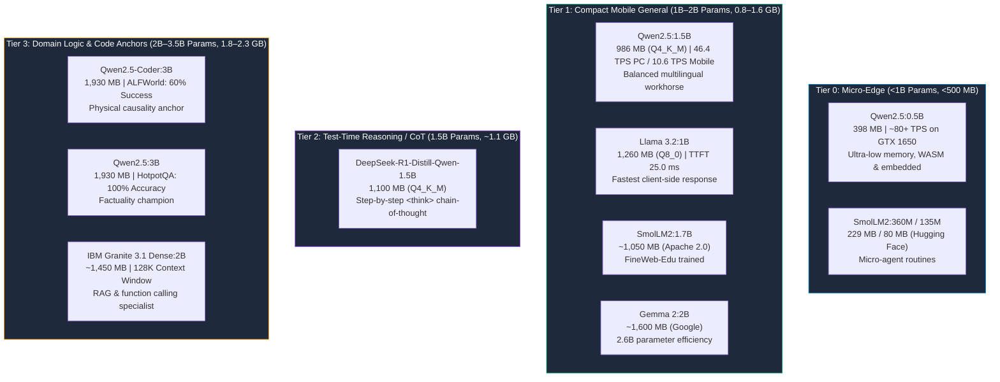

# Edge Small Language Models (SLMs) Landscape: 2025–2026

> **Target Hardware Architectures:**
> - **Host Workstation:** NVIDIA GeForce GTX 1650 (4,096 MB VRAM, CUDA)
> - **Mobile Edge Target:** realme 9 Pro+ / MediaTek Dimensity 920 (8,192 MB Unified RAM, ARM64 NEON)

---

## 1. Executive Overview & The Edge Parameter Shift

In 2025–2026, the paradigm of local language modeling bifurcated:
1. **Frontier Cloud LLMs (70B–671B+):** Centralized, power-intensive models requiring multi-GPU server clusters.
2. **Specialized Edge SLMs (0.5B–3.5B):** High-density models engineered to run inside consumer memory envelopes (<4GB VRAM, <8GB mobile RAM) with microsecond latency, zero cloud dependency, and total privacy.

Through extensive empirical testing in **Pocket AI Lab**, we categorize modern edge models into **Four Functional Tiers**.

---

## 2. The Four Functional Tiers of Edge Models

---

## 3. In-Depth Model Profiles

### 3.1 Tier 0: Micro-Edge Models (<1B)

#### 1. `qwen2.5:0.5b` (Alibaba Cloud)
- **Parameter Count:** 0.49 Billion | **Quantization:** Q4_K_M (~398 MB disk weight)
- **Estimated VRAM:** ~798 MB (with 400 MB context buffer)
- **Hardware Viability:** Fits 100% in GTX 1650 VRAM (utilizes only 19.5% of the 4GB buffer). Runs comfortably on mobile phones with <2GB free RAM.
- **Projected Throughput:** **~70–90+ Decode TPS** on GTX 1650.
- **Strengths:** Blazing fast token generation, near-zero Time-to-First-Token (<15ms), low power consumption.
- **Weaknesses:** Prone to hallucination on multi-hop questions; limited multi-step logic.
- **Best Use Case:** Text classification, intent recognition, fast keyword extraction, local input sanitization.

#### 2. `smollm2:360m` / `smollm2:135m` (Hugging Face)
- **Parameter Count:** 360M / 135M | **License:** Apache 2.0
- **Disk Weight:** ~229 MB (360M) / ~80 MB (135M)
- **Hardware Viability:** Extreme edge (Raspberry Pi 4/5, in-browser WebAssembly, microcontrollers).
- **Best Use Case:** On-device autocorrect, lightweight syntax checkers, IoT command dispatching.

---

### 3.2 Tier 1: Compact Mobile General (1B–2B)

#### 1. `qwen2.5:1.5b` (Alibaba Cloud)
- **Disk Weight:** 986 MB (Q4_K_M) | **Measured Peak VRAM:** 1,293 MB (31.6% budget)
- **Empirical Measured Speed:**
  - Host PC (GTX 1650): **354.2 Prompt TPS | 46.41 Decode TPS | TTFT 33.9 ms**
  - Mobile (Dimensity 920): **16.1 Prompt TPS | 10.64 Decode TPS | 2.66 Tokens/Watt**
- **Strengths:** Exceptional multilingual fidelity (Devanagari Hindi, French, English), clean JSON schema generation, high prompt speed.
- **Weaknesses:** 0% ALFWorld embodied planning success without external state verifiers.

#### 2. `llama3.2:1b` (Meta AI)
- **Disk Weight:** 1,260 MB (Q8_0) | **Measured Peak VRAM:** 1,622 MB (39.6% budget)
- **Empirical Measured Speed:** **338.4 Prompt TPS | 43.91 Decode TPS | TTFT 25.0 ms (Fastest TTFT)**
- **Strengths:** Outstanding TTFT responsiveness, high precision (Q8_0 quantization level).
- **Weaknesses:** 40% HotpotQA factual accuracy; struggles with complex non-code distractor contexts.

#### 3. `smollm2:1.7b` (Hugging Face)
- **Disk Weight:** ~1,050 MB (Q4_K_M) | **License:** Permissive Apache 2.0
- **Training Corpus:** Curated educational data (FineMath, Stack-Edu, SmolTalk).
- **Strengths:** Fully open training pipeline and dataset, high math/code capability for a 1.7B model.
- **Best Use Case:** Commercial mobile assistants where training provenance and Apache 2.0 licensing are non-negotiable.

#### 4. `gemma2:2b` (Google DeepMind)
- **Disk Weight:** ~1,600 MB (Q4_K_M) | **Estimated VRAM:** ~2,000 MB (48.8% budget)
- **Strengths:** Architectural innovations inherited from Gemma 2 9B/27B (interleaved sliding-window attention), high text coherence.
- **Weaknesses:** Higher memory consumption than 1.5B competitors.

---

### 3.3 Tier 2: Test-Time Reasoning / Distilled CoT

#### 1. `deepseek-r1:1.5b` (DeepSeek AI)
- **Parameter Count:** 1.5B (Distilled from Qwen2.5-1.5B base)
- **Disk Weight:** ~1,100 MB (Q4_K_M) | **Estimated VRAM:** ~1,500 MB (36.6% budget)
- **The Core Innovation:** Introduces **Test-Time Compute** to edge hardware. The model generates internal `<think> ... </think>` reasoning tokens before outputting its answer.
- **Why It Matters for Edge AI:**
  - Traditional SLMs fail at complex logic because they predict the next token greedily without scratchpad verification.
  - DeepSeek-R1-1.5B applies chain-of-thought distillation to break math and algorithmic logic into explicit verification steps.
- **Trade-Off on Hardware:** Generates 2x–5x more tokens per query due to the reasoning trace, resulting in higher end-to-end turnaround latency on mobile CPUs.

---

### 3.4 Tier 3: Domain Logic & Code Anchors (2B–3.5B)

#### 1. `qwen2.5-coder:3b` (Alibaba Cloud)
- **Disk Weight:** 1,930 MB (Q4_K_M) | **Measured Peak VRAM:** 2,227 MB (54.4% budget)
- **Empirical Measured Speed:** **204.6 Prompt TPS | 21.40 Decode TPS | TTFT 41.1 ms**
- **Core Scientific Finding:** Anchors embodied planning—achieved **60.0% success on ALFWorld with 0% invalid actions** (tripling the general 3B model).
- **Trade-Off:** 40% factual hallucination rate on non-code domains.

#### 2. `qwen2.5:3b` (Alibaba Cloud)
- **Disk Weight:** 1,930 MB (Q4_K_M) | **Measured Peak VRAM:** 2,228 MB (54.4% budget)
- **Empirical Measured Speed:** **196.2 Prompt TPS | 19.44 Decode TPS | TTFT 46.8 ms**
- **Core Scientific Finding:** Factuality champion—achieved **100% accuracy on HotpotQA with 0% hallucination**.

#### 3. `granite3.1-dense:2b` (IBM Research)
- **Parameter Count:** 2.0B | **Disk Weight:** ~1,450 MB | **Context Window:** **128,000 Tokens**
- **License:** Apache 2.0
- **Strengths:** Specifically fine-tuned for enterprise RAG, tool calling, and structured JSON output. Holds the largest supported context window among sub-3B open models.

---

## 4. Hardware Allocation & VRAM Budget Matrix

| Model Tag | Params | Quant Level | Disk Size | Peak VRAM on PC | GTX 1650 Fit (4GB) | Android Fit (8GB) | Primary Role |
| :--- | :---: | :---: | :---: | :---: | :---: | :---: | :--- |
| **`qwen2.5:0.5b`** | 0.5B | Q4_K_M | **398 MB** | ~798 MB | **✔ FITS (19.5%)** | **✔ FITS (9.7%)** | Micro-Edge / Fast Filter |
| **`qwen2.5:1.5b`** | 1.5B | Q4_K_M | **986 MB** | **1,293 MB** | **✔ FITS (31.6%)** | **✔ FITS (14.4%)** | Mobile Multilingual Workhorse |
| **`deepseek-r1:1.5b`** | 1.5B | Q4_K_M | **1,100 MB** | ~1,500 MB | **✔ FITS (36.6%)** | **✔ FITS (15.8%)** | Edge Chain-of-Thought Reasoning |
| **`llama3.2:1b`** | 1.2B | Q8_0 | **1,260 MB** | **1,622 MB** | **✔ FITS (39.6%)** | **✔ FITS (18.1%)** | Ultra-Low TTFT Assistant |
| **`smollm2:1.7b`** | 1.7B | Q4_K_M | **1,050 MB** | ~1,450 MB | **✔ FITS (35.4%)** | **✔ FITS (15.3%)** | Open-Data / Apache 2.0 Chat |
| **`granite3.1-dense:2b`** | 2.0B | Q4_K_M | **1,450 MB** | ~1,850 MB | **✔ FITS (45.1%)** | **✔ FITS (21.0%)** | 128K Long-Context RAG |
| **`gemma2:2b`** | 2.6B | Q4_K_M | **1,600 MB** | ~2,000 MB | **✔ FITS (48.8%)** | **✔ FITS (23.2%)** | High-Quality Dialogue |
| **`qwen2.5:3b`** | 3.1B | Q4_K_M | **1,930 MB** | **2,228 MB** | **✔ FITS (54.4%)** | **✔ FITS (27.5%)** | General Multi-Hop Knowledge |
| **`qwen2.5-coder:3b`** | 3.1B | Q4_K_M | **1,930 MB** | **2,227 MB** | **✔ FITS (54.4%)** | **✔ FITS (27.5%)** | Embodied Sequential Planning |
| *Llama-3.1-8B* | 8.0B | Q4_K_M | ~4,800 MB | ~5,200 MB | ✘ SPILL (127% OOM) | ✘ Unsafe | Out-of-Budget Baseline |

---

## 5. Summary Recommendation for Pocket AI Lab

1. **For Maximum Generation Speed:** Deploy **`qwen2.5:0.5b`** to evaluate throughput boundaries (>70 TPS on PC, >25 TPS on mobile).
2. **For Step-by-Step Logic:** Ingest **`deepseek-r1:1.5b`** to benchmark whether distilled `<think>` reasoning traces eliminate the ALFWorld embodied causality deficit observed in raw 1.5B models.
3. **For Long-Context Tool Calling:** Benchmark **`granite3.1-dense:2b`** to stress test 128K context window KV-cache expansion.
