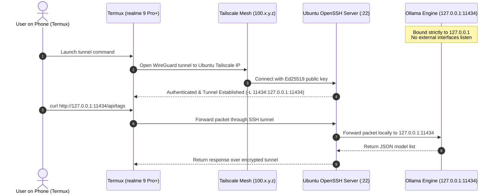

# Pocket AI Lab — Remote Access & Loopback Runbook (Phase 1)

This runbook details how to securely connect the **realme 9 Pro+** (client) to this **Ubuntu PC** (host) over **Tailscale** and an **SSH encrypted tunnel** to access the loopback-bound Ollama API.

---

## 1. Security Architecture & Threat Model



### Security Rules Verified
1. **Loopback Isolation:** Ollama listens only on `127.0.0.1:11434`. Public interfaces (`0.0.0.0`) cannot connect directly.
2. **Key-Only Authentication:** Password authentication disabled; only Ed25519 public keys permitted.
3. **No Root Login:** `PermitRootLogin no`.
4. **Private Transport:** Traffic passes through Tailscale WireGuard mesh + SSH TLS/crypto layer.

---

## 2. Ubuntu Host Setup (Requires Confirmation / Sudo)

The following commands configure the OpenSSH server on Ubuntu:

### Step 2.1: Install & Start OpenSSH Server
```bash
sudo apt update && sudo apt install -y openssh-server
sudo systemctl enable --now ssh
```

### Step 2.2: Harden SSH Configuration
Create a dedicated hardening drop-in configuration at `/etc/ssh/sshd_config.d/99-pocket-ai-lab.conf`:
```bash
sudo bash -c 'cat << "EOF" > /etc/ssh/sshd_config.d/99-pocket-ai-lab.conf
# Pocket AI Lab Hardening Configuration
PermitRootLogin no
PasswordAuthentication no
PubkeyAuthentication yes
AuthorizedKeysFile .ssh/authorized_keys
AllowTcpForwarding yes
X11Forwarding no
MaxAuthTries 3
EOF'

# Validate config syntax and restart sshd
sudo sshd -t && sudo systemctl restart ssh
```

### Step 2.3: Retrieve Ubuntu Host Fingerprint & Tailscale IP
Run these commands to print the fingerprint and IP to verify from your phone:
```bash
# Print Ed25519 host key SHA256 fingerprint:
ssh-keygen -lf /etc/ssh/ssh_host_ed25519_key.pub

# Print Tailscale IPv4 address (if Tailscale is running):
tailscale ip -4
```

---

## 3. Phone Setup: realme 9 Pro+ (Termux + Tailscale)

### Step 3.1: Install Termux & Tailscale on Phone
1. Install **Tailscale** from the Google Play Store or F-Droid, log in, and ensure it is connected to your Tailnet.
2. Install **Termux** (recommended: from F-Droid or GitHub releases for current Android 13 support).

### Step 3.2: Install Required Termux Packages
Open Termux on the phone and execute:
```bash
pkg update && pkg install -y openssh curl
```

### Step 3.3: Generate an Ed25519 SSH Keypair on the Phone
In Termux:
```bash
# Generate key without passphrase (or with passphrase for extra security):
ssh-keygen -t ed25519 -C "realme9proplus-pocket-ai-lab" -f ~/.ssh/id_ed25519

# Print the public key:
cat ~/.ssh/id_ed25519.pub
```

### Step 3.4: Authorize Phone Key on Ubuntu PC
Copy the printed line from Step 3.3 (it starts with `ssh-ed25519 AAAAC3...`), and append it to `~/.ssh/authorized_keys` on Ubuntu:
```bash
mkdir -p ~/.ssh && chmod 700 ~/.ssh
echo "<COPIED_KEY_STRING_FROM_PHONE>" >> ~/.ssh/authorized_keys
chmod 600 ~/.ssh/authorized_keys
```

### Step 3.5: Open the Secure SSH Tunnel from Termux
In Termux, replace `<UBUNTU_USER>` with your Ubuntu username (e.g. `abhishek`) and `<UBUNTU_TAILSCALE_IP>` with the `100.x.y.z` address of this machine:

```bash
# First connection - will prompt to verify host fingerprint:
ssh -N -L 11434:127.0.0.1:11434 <UBUNTU_USER>@<UBUNTU_TAILSCALE_IP>
```

> [!TIP]
> To run the tunnel in the background in Termux so you can run queries in the same session:
> ```bash
> ssh -f -N -L 11434:127.0.0.1:11434 <UBUNTU_USER>@<UBUNTU_TAILSCALE_IP>
> ```

### Step 3.6: Verify Tunnel Connectivity from Termux
In a Termux terminal while the tunnel is active:
```bash
# Test version endpoint:
curl http://127.0.0.1:11434/api/version

# Test available tags / models endpoint:
curl http://127.0.0.1:11434/api/tags
```

**Expected output:**
```json
{"version":"0.34.4"}
```
And a JSON payload listing available models on your Ubuntu PC.

---

## 4. Helper Script for Termux (`pocket-tunnel.sh`)
Save this on the realme 9 Pro+ in `~/pocket-tunnel.sh`:
```bash
cat << 'EOF' > ~/pocket-tunnel.sh
#!/data/data/com.termux/files/usr/bin/bash
HOST="<UBUNTU_USER>@<UBUNTU_TAILSCALE_IP>"
PORT="11434"

echo "[Pocket AI Lab] Checking if tunnel already active on :$PORT..."
if curl -s --max-time 1 "http://127.0.0.1:$PORT/api/version" >/dev/null; then
    echo "[Pocket AI Lab] Tunnel already active!"
else
    echo "[Pocket AI Lab] Launching background SSH tunnel to $HOST..."
    ssh -f -N -L "$PORT:127.0.0.1:$PORT" "$HOST"
    sleep 1
    if curl -s --max-time 2 "http://127.0.0.1:$PORT/api/version" >/dev/null; then
        echo "[Pocket AI Lab] Connected successfully! Ollama reachable at http://127.0.0.1:$PORT"
    else
        echo "[Pocket AI Lab] Error: Failed to reach Ollama via tunnel."
        exit 1
    fi
fi
EOF
chmod +x ~/pocket-tunnel.sh
```
