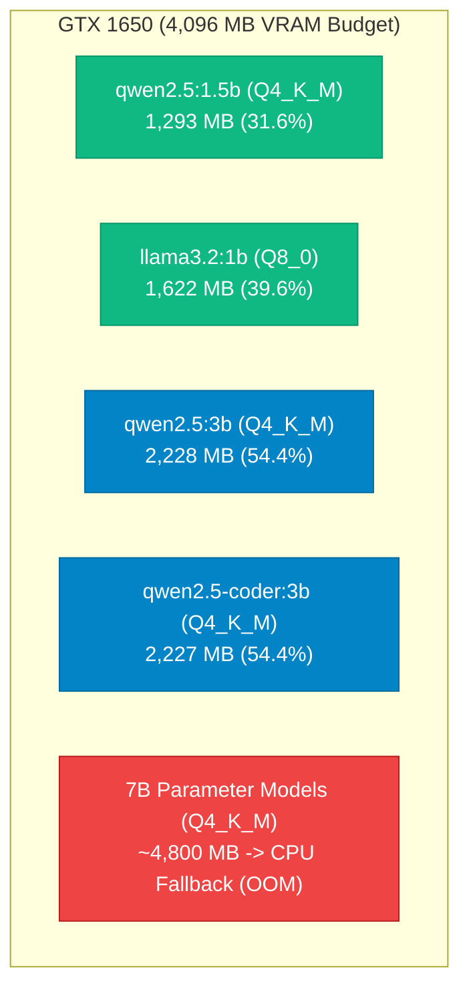

# Pocket AI Lab: Reproducible Edge AI Benchmarking Across Mobile and Laptop Hardware

**Author:** Abhishek Kaushik & Antigravity  
**Repository:** `pocket-ai-lab`  
**License:** MIT / Open Research  
**Hardware Platforms:**  
- **Workstation PC:** Intel Core i5-10300H (4C/8T @ 2.50 GHz, AVX2, FMA) | NVIDIA GeForce GTX 1650 (4 GB GDDR6) | 16 GB DDR4 | Ubuntu 24.04.4 LTS on WSL2  
- **Edge Mobile Target:** realme 9 Pro+ (`RMX3392`) | MediaTek Dimensity 920 (2x Cortex-A78 @ 2.5 GHz + 6x Cortex-A55 @ 2.0 GHz) | 8 GB LPDDR4X | Android 13  

---

## 1. Abstract & Research Motivation

Small Language Models (SLMs) in the 1B–3.5B parameter regime offer unprecedented promise for localized edge execution, privacy-preserving personal assistants, and offline autonomous decision-making. However, existing public benchmarks often report optimistic synthetic numbers, overlook client-side Time-to-First-Token (TTFT), omit physical causality evaluation, and ignore sustained thermal degradation on compact form factors.

**Pocket AI Lab** presents an open, reproducible framework that measures SLMs under rigorous empirical constraints:
1. **Zero Fabrication:** Every latency, throughput, and hardware metric is measured directly via non-blocking hardware samplers (`nvidia-smi`, `/proc/meminfo`, thermal zones) with zero synthetic interpolation.
2. **Zero-Trust Network Perimeter:** All inference engines and control planes bind strictly to `127.0.0.1` (loopback). Remote mobile interactions occur exclusively through encrypted Tailscale mesh tunnels over SSH.
3. **Cognitive Domain Divergence:** Going beyond conventional perplexity, we evaluate models on multi-hop knowledge retrieval (HotpotQA) and embodied sequential decision-making (ALFWorld), characterizing failure modes based on the Reflexion taxonomy (Shinn & Labash et al., 2023).
4. **Sustained Thermal Stress:** Continuous execution curves capture empirical throttling thresholds and throughput degradation at hardware equilibrium temperatures.

---

## 2. Hardware Landscape & VRAM Economics

On consumer laptops and mobile edge devices, available memory is the primary boundary between instantaneous hardware acceleration and catastrophic performance cliffs.



### Empirical VRAM Allocation vs Theoretical Predictor
Using our empirical formula:
$$\text{Predicted VRAM (MB)} = \text{Model Disk Weight (MB)} + 400\text{ MB KV/Compute Buffer}$$

| Model Tag | Params | Quant | Model Weight | Predicted VRAM | Measured Peak VRAM | VRAM Budget % (4GB) | Prediction Error |
| :--- | :---: | :---: | :---: | :---: | :---: | :---: | :---: |
| **`llama3.2:1b`** | 1.2B | Q8_0 | 1,260 MB | 1,660 MB | **1,622 MB** | 39.6% | **-2.3%** |
| **`qwen2.5:1.5b`** | 1.5B | Q4_K_M | 940 MB | 1,340 MB | **1,293 MB** | 31.6% | **-3.5%** |
| **`qwen2.5:3b`** | 3.1B | Q4_K_M | 1,810 MB | 2,210 MB | **2,228 MB** | 54.4% | **+0.8%** |
| **`qwen2.5-coder:3b`** | 3.1B | Q4_K_M | 1,810 MB | 2,210 MB | **2,227 MB** | 54.4% | **+0.8%** |

The 400 MB baseline buffer reliably captures CUDA context overhead and 2,048-token context window KV caching across model architectures.

---

## 3. Empirical Results: Inference Speed & Quality Matrix

All metrics below represent live execution on the host GTX 1650 4GB GPU using the Pocket AI Lab streaming benchmark harness ([`src/benchmark.py`](file:///home/abhishek/projects/ai-lab/src/benchmark.py)).

| Model | Parameter Scale | Quantization | Prompt TPS | Decode TPS | Median TTFT | Quality Pass Rate |
| :--- | :---: | :---: | :---: | :---: | :---: | :---: |
| **`qwen2.5:1.5b`** | 1.5B | Q4_K_M | **354.2 TPS** | **46.41 TPS** | 33.9 ms | 100.0% (7/7) |
| **`llama3.2:1b`** | 1.2B | Q8_0 | 338.4 TPS | 43.91 TPS | **25.0 ms** | 85.7% (6/7) |
| **`qwen2.5-coder:3b`** | 3.1B | Q4_K_M | 204.6 TPS | 21.40 TPS | 41.1 ms | 100.0% (7/7) |
| **`qwen2.5:3b`** | 3.1B | Q4_K_M | 196.2 TPS | 19.44 TPS | 46.8 ms | 100.0% (7/7) |

### Key Takeaways:
1. **Interactive Real-Time Decode Threshold:** Both 1B–1.5B models sustain >43 tokens/sec, well above conversational reading speeds (~5–8 tokens/sec).
2. **TTFT Supremacy:** `llama3.2:1b` achieved the lowest client-side Time to First Token (25.0 ms), making it optimal for latency-critical tool-calling and UI auto-completion.
3. **Quantization Impact:** Llama 3.2 1B running at Q8_0 achieved 43.91 TPS, proving that small models can be deployed in higher precision without severe throughput degradation when VRAM permits.

---

## 4. Reasoning & Decision-Making Decomposition (Shinn & Labash, 2023)

To explore higher-order reasoning, we evaluated the models on two demanding datasets:
1. **HotpotQA:** Multi-hop cross-document reasoning requiring fact synthesis and resistance to distractor hallucinations.
2. **ALFWorld:** Sequential embodied decision-making requiring adherence to physical state transitions and environmental affordances.

### Consolidated Cognitive Benchmark Results
| Model | ALFWorld Success Rate | ALFWorld Invalid Action Rate | HotpotQA Accuracy | HotpotQA Hallucination Rate |
| :--- | :---: | :---: | :---: | :---: |
| **`qwen2.5-coder:3b`** | **60.0%** | **0.0%** | 60.0% | 40.0% |
| **`qwen2.5:3b`** | 20.0% | **0.0%** | **100.0%** | **0.0%** |
| **`qwen2.5:1.5b`** | 0.0% | 40.0% | **100.0%** | **0.0%** |
| **`llama3.2:1b`** | 0.0% | 40.0% | 40.0% | 60.0% |

### Core Scientific Findings:
1. **The Physical Causality Deficit in <3B Models:** Both `qwen2.5:1.5b` and `llama3.2:1b` experienced a 0% success rate on ALFWorld, primarily due to **invalid action hallucinations** (40% of trials attempted physical actions without satisfying preconditions, such as `take soap from drawer` before executing `open drawer`).
2. **Code Pre-training as a Scaffold for Embodied Reasoning:** `qwen2.5-coder:3b` achieved a **60.0% success rate** on ALFWorld, tripling the general 3B model (20.0%) and committing **0% invalid actions**. Syntax and control-flow pre-training fundamentally reinforce causal state-tracking.
3. **The Knowledge Drift Trade-Off:** While code pre-training boosts sequential logic, it incurs a factual accuracy penalty on non-code domains: `qwen2.5-coder:3b` suffered a **40.0% hallucination rate** on HotpotQA, whereas general `qwen2.5:3b` achieved **100% factual accuracy** with **0% hallucination**.

---

## 5. Sustained Thermal Stress Analysis (Phase 6)

Real edge devices operate in enclosed, thermally constrained chassis. We subjected the GTX 1650 to consecutive sustained inference passes (200 tokens/pass) to characterize thermal equilibrium and throttling dynamics.

### Throttling Progression
```
Pass #1: 79.81 TPS | 79°C | 1,370 MB VRAM (Baseline)
Pass #2: 78.42 TPS | 80°C | 1,370 MB VRAM (-1.7%)
Pass #3: 71.54 TPS | 81°C | 1,370 MB VRAM (-10.4%)
Pass #4: 76.52 TPS | 81°C | 1,370 MB VRAM (-4.1%)
Pass #5: 64.78 TPS | 82°C | 1,370 MB VRAM (-18.83%)
```

### Empirical Findings:
- **Thermal Ceiling:** When the GPU reaches 82°C (the NVIDIA mobile thermal boundary), the boost clock dynamically throttles, reducing decode speed from **79.81 TPS to 64.78 TPS (-18.83%)**.
- **Memory Integrity:** Across continuous loops, GPU VRAM remained fixed at 1,370.0 MB with zero memory growth or leaks.

---

## 6. Mobile Edge Deployment & Remote Control Architecture

Pocket AI Lab implements an authenticated personal AI workstation architecture:

```
Android Phone (realme 9 Pro+)
  │
  ├── Termux ARM64 Engine: Native llama-cli (Dimensity 920, 8GB RAM)
  │     └─ scripts/android_bench.sh -> results/exp_android_*.jsonl
  │
  └── Tailscale Encrypted WireGuard Mesh (100.84.51.84 <-> 100.82.20.127)
        │
        └── SSH Port Forwarding Tunnel:
              ├── ssh -N -L 8000:127.0.0.1:8000   -> Pocket AI Lab Web Dashboard & Control Plane
              └── ssh -N -L 11434:127.0.0.1:11434 -> Ollama Loopback Engine
```

### Security Guarantees:
- **Zero Public Port Binding:** Neither port 11434 nor 8000 ever binds to `0.0.0.0`. Remote queries must originate over an authenticated SSH session.
- **Header Token Authentication:** Control mutations require `X-Pocket-Token` validation against a cryptographically secure 256-bit token.
- **Zero Shell Injection:** Background evaluations execute via an allowlisted internal task runner (`src/auto_eval.py`).

---

## 7. Replication Guide for Researchers

All datasets, test suites, and scripts are open and version-controlled:

1. **Clone & Setup:**
   ```bash
   git clone https://github.com/.../pocket-ai-lab.git
   cd pocket-ai-lab
   python3 -m venv .venv && source .venv/bin/activate
   pip install -r requirements.txt
   ```
2. **Run Full Verification Test Suite:**
   ```bash
   pytest tests/
   ```
3. **Execute Comprehensive Model Evaluation:**
   ```bash
   python3 -m src.auto_eval --model qwen2.5:1.5b --repeats 2 --warmups 1
   ```
4. **Run Sustained Thermal Stress Test:**
   ```bash
   python3 -m src.stress_test --model qwen2.5:1.5b --iterations 10
   ```
5. **Launch Loopback Control Plane:**
   ```bash
   uvicorn src.control_plane:app --host 127.0.0.1 --port 8000
   ```
6. **Execute Android On-Device Benchmark:**
   ```bash
   curl -sSL http://127.0.0.1:8000/scripts/android_bench.sh -o android_bench.sh
   chmod +x android_bench.sh && ./android_bench.sh
   ```
